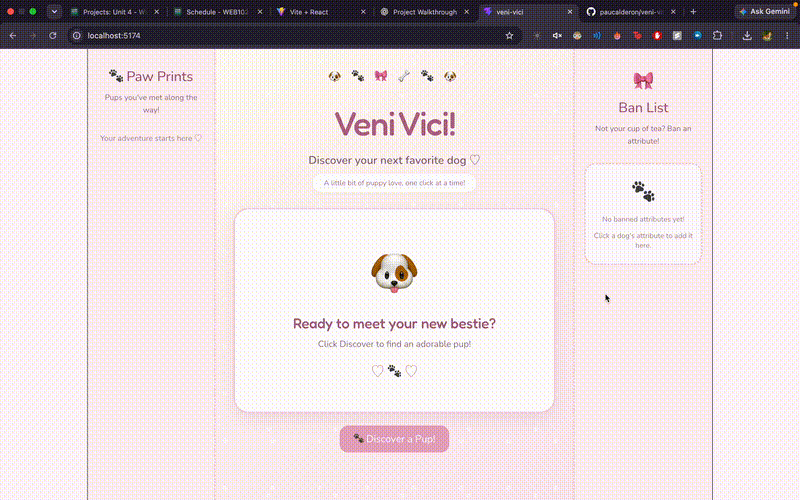

# *Veni Vici!*

Submitted by: **Ana Calderón**

This web app: **Veni Vici!** is a dog breed discovery app that lets users explore different dog breeds using TheDogAPI. Users can discover random dogs, view their images and characteristics, and add attributes to a customizable ban list to filter future results.

Time spent: **12 hours** spent in total

## Required Features

The following **required** functionality is completed:

- [x] **Application features a button that creates a new API fetch request on click and displays at least three attributes and an image obtained from the returned JSON data**
  - Clicking the Discover button fetches dog breed data from TheDogAPI and displays the dog's name, life span, temperament, breed group, and image.

- [x] **Only one item/data from API call response is viewable at a time and at least one image is displayed per API call**
  - Each click displays one dog breed and its corresponding image and attributes.

- [x] **API call response results appear random to the user**
  - Each click selects a random breed from the available results.

- [x] **Clicking on a displayed value for one attribute adds it to a displayed ban list**
  - Users can click attributes such as temperament traits, life span, and breed group to add them to the ban list.
  - Clicking an attribute already in the ban list does not add a duplicate.

- [x] **Attributes on the ban list prevent further images/API results with that attribute from being displayed**
  - The app filters out breeds that match banned names, life spans, breed groups, or temperament traits before selecting a random result.
  - Clicking an item in the ban list removes it, allowing that attribute to appear in future results again.

## Optional Features

- [x] **Multiple types of attributes are clickable and can be added to the ban list**
  - Users can ban different types of dog attributes, including life span, breed group, and temperament traits.

- [ ] **Users can see a stored history of their previously displayed results from this session**
  - A history section was not implemented.

## Additional Features

- [x] Random dog breed discovery using TheDogAPI.
- [x] A customizable ban list with the ability to remove banned attributes.
- [x] Case-insensitive matching when filtering banned attributes.

## Video Walkthrough

Here's a walkthrough of the implemented user stories:

GIF created with **FFmpeg**.

## Notes

One challenge I encountered was understanding I needed to use `.toLowerCase()` when comparing banned attributes with the dog breed data. I initially started by implementing the ban list for temperament traits, and then worked on making sure the filtering logic applied to all the other attributes as well, including names, life spans, and breed groups. I had to make sure the comparisons worked regardless of capitalization so that banned attributes would consistently be filtered out.

I also spent a lot more time on CSS this time around because I wanted to improve the overall appearance of the app and make the layout and buttons look better. This helped me get more practice with styling and making the user interface more polished.

## License

Copyright 2026 Ana Calderón

Licensed under the Apache License, Version 2.0 (the "License");
you may not use this file except in compliance with the License.
You may obtain a copy of the License at

http://www.apache.org/licenses/LICENSE-2.0

Unless required by applicable law or agreed to in writing, software
distributed under the License is distributed on an "AS IS" BASIS,
WITHOUT WARRANTIES OR CONDITIONS OF ANY KIND, either express or implied.
See the License for the specific language governing permissions and
limitations under the License.

